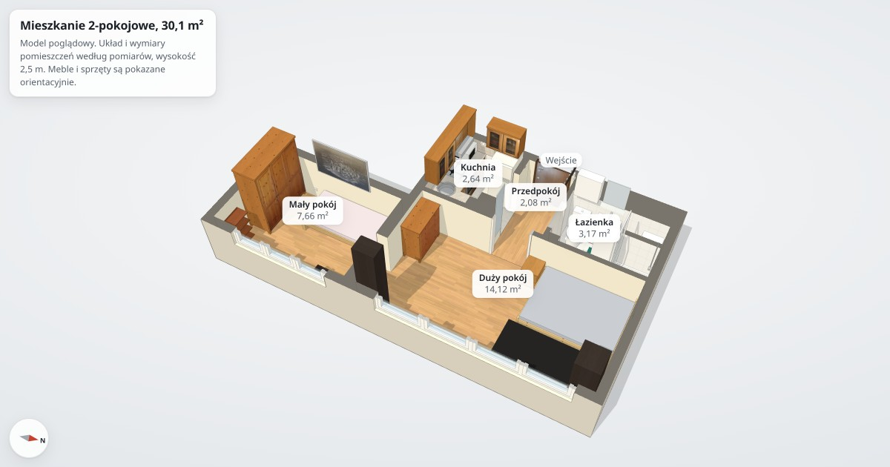

# Wirtualny spacer / Virtual tour

**Otwórz wirtualny spacer: [bzaczynski.github.io/wirtualny-spacer](https://bzaczynski.github.io/wirtualny-spacer/)**

Mieszkanie 2-pokojowe, 30,1 m², Kraków. Model 3D z wymiarami pomieszczeń, zdjęcia
w miejscach, w których zostały zrobione, i słońce w oknach o każdej porze roku. Działa
w przeglądarce, także na telefonie.

**Open the virtual tour: [bzaczynski.github.io/wirtualny-spacer](https://bzaczynski.github.io/wirtualny-spacer/)**

A 2-room flat of 30.1 m² in Kraków. A 3D model with room sizes, photos placed where they
were taken, and the sun in the windows at any time of year. It runs in the browser, on a
phone too.
